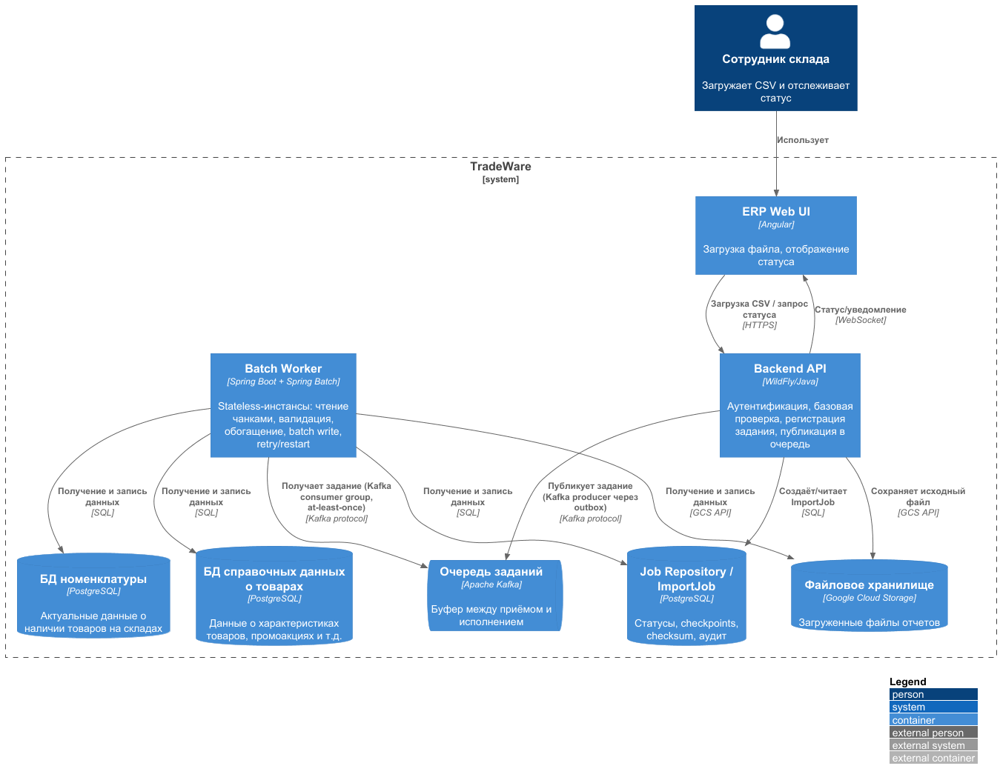

# ADR-001: Пакетная обработка загрузок остатков с использованием Spring Batch

## Общая информация

1. Автор ADR - Дмитрий Ренев
2. Статус - На согласовании
3. Согласующие - Дмитрий Бардин

## Контекст

TradeWare ежедневно обрабатывает около 400 тыс. строк отчётов об остатках и перемещениях, поступающих с региональных складов в виде файлов. 
В пиковые периоды (весна–лето, крупные объекты) нагрузка возрастает в 2–3 раза. Необходимо перевести загрузку отчётов из построчного онлайн-режима в пакетную обработку так, 
чтобы система стабильно работала под нагрузкой и масштабировалась при росте бизнеса.

Целевые ограничения:

| Тип | Требование |
|---|---|
| Производительность | 2 000 строк - в среднем ≤30 с |
| Нагрузка | 100–150 параллельных загрузок в пиковые часы |
| Масштабирование | Горизонтальное, без переработки логики |
| Надёжность | Restartability, retry временных сбоев, идемпотентность |
| Интеграция | Java 11, WildFly, PostgreSQL, GCS, постепенный выход из монолита |
| Данные | Валидация, обогащение справочниками, загрузка в целевую таблицу |

### Анализ проблем

При низкой нагрузке интерфейсы отзывчивы, а логистические цепочки формируются без сбоев, значит, бизнес-логика и UI сами по себе работоспособны, а причина деградации в способе обработки данных и в отсутствии адаптации под нагрузку.

**Симптомы:**
- Отчёты по остаткам «висят», обновления позиций приходят с большой задержкой либо не применяются вовсе.
- Замедляется работа ERP-интерфейса при формировании складских заданий и приёме материалов.
- При ошибках трудно локализовать причину: есть только логи в файл и стандартный мониторинг ресурсов VM и WildFly.

**Корневые причины:**
1. **Отсутствие пакетной обработки (главная причина).** Каждая запись обрабатывается отдельно в онлайн-режиме: множество мелких транзакций и сетевых round-trip к БД, невозможность set-based операций. Пропускная способность ограничена количеством строк линейно, а не производительностью БД.
2. **Перегрузка транзакционных ресурсов БД.** Построчные `INSERT/UPDATE` конкурируют за блокировки строк, версии и WAL/журнал. Под нагрузкой растёт время удержания блокировок, появляются очереди на lock, время уходит на ожидание, а не на полезную работу.
3. **Смешение онлайн- и batch-нагрузки в одном контуре.** Монолит использует общий пул соединений и ресурсы и для интерактивных запросов, и для тяжёлой загрузки. Один поток данных тормозит остальные (взаимное блокирование): медленная загрузка отчёта напрямую ухудшает отзывчивость ERP.
4. **Синхронная отчётность и обработка в реальном времени.** То, что можно вынести в ночную пакетную обработку, выполняется в момент запроса пользователя, конкурируя с интерактивными операциями.
5. **Отсутствие средств мониторинга и наблюдаемости.** Нет централизованного сбора логов и метрик, нет трассировки по заданию. Невозможно быстро отличить сбой данных от нехватки ресурсов.
6. **Отсутствие retry, идемпотентности и гибкого пайплайна.** При сбое нет управляемого перезапуска без повторной обработки уже применённых данных; нет механизмов повторов временных ошибок; пайплайн жёстко связан с одним форматом, что мешает подключать новые источники.

**Почему проблема усиливается в пике.** Нагрузка растёт в 2–3 раза, а система не масштабируется адекватно: конкуренция за соединения и блокировки растёт нелинейно, время удержания блокировок увеличивается, 
латентность накапливается каскадом. Задержки загрузки мешают планировать снабжение, провоцируют просрочки поставок и цепные задержки в строительных процессах клиентов.

**Следствия для решения:**
- Перевод обработки в **пакетный (chunked) режим** с крупными пакетами и короткими транзакциями на chunk.
- **Разделение приёма и исполнения** (очередь-буфер), чтобы сглаживать пики и сохранять отзывчивость API.
- **Управляемый параллелизм и горизонтальное масштабирование** исполнения.
- **Restartability, retry временных сбоев, идемпотентность** и корреляция по `jobId`.
- **Наблюдаемость** (логи, метрики, статусы) - детализируется отдельным ADR.
- **Разнесение транзакционной (онлайн) и аналитической (batch)** нагрузки по ресурсам.

## Рассмотренные варианты

### Вариант №1 «Spring Batch как ETL-движок в отдельном worker-сервисе»
Отдельный Spring Boot worker-сервис со Spring Batch, не внутри HTTP request thread монолита. Job из шагов: чтение CSV чанками, валидация, обогащение справочниками, 
batch-запись. Поддерживает chunk processing, checkpoint/restart, retry/skip/listeners. Запускается из очереди; статус отдаётся через API.

### Вариант №2 «Apache Beam / Google Cloud Dataflow»
Распределённый пайплайн (batch + streaming), GCP-first. Мощная модель окон, автоскейлинг, естественная интеграция с GCS/BigQuery. 
Выше концептуальная и операционная сложность, привязка к облаку.

### Вариант №3 «Apache Spark»
Кластерные распределённые вычисления для очень больших объёмов и сложных преобразований. 
Избыточен для сотен тысяч строк в сутки: отдельный кластер, memory-оверхед, настройка и эксплуатация.

### Вариант №4 «Quartz + собственный ETL»
Планировщик Quartz и собственная реализация ETL. Гибко для простых расписаний, но checkpoint, retry/skip, 
транзакционные chunk-и и аудит надо реализовывать самостоятельно.

### Вариант №5 «Kafka Streams / event-driven consumers»
Непрерывная потоковая обработка событий с малой задержкой. Это не замена файловому batch ETL: 
требует событийной модели и брокера, не даёт готового chunk/restart-механизма.

### Вариант №6 «PostgreSQL staging + set-based SQL»
Загрузка в staging и преобразование силами SQL/merge. Сильный вариант для реляционных set-based преобразований, 
но менее удобен для сложной построчной валидации, retry-логики и перезапуска шагов.

## Сравнение альтернатив

| Вариант решения | Преимущества | Недостатки |
|---|---|---|
| №1 «Spring Batch worker» | - Нативный chunk processing, транзакции на chunk, checkpoint/restart - Retry/skip/listeners для бизнес-валидации - Partitioning/remote chunking для масштабирования - Естественная интеграция с Java/JDBC/PostgreSQL/Actuator/Micrometer - Низкий порог внедрения для команды с опытом Spring Batch | - Требует JobRepository, управления параллелизмом и эксплуатации worker-сервиса - Сам по себе не брокер очередей и не даёт распределённой оркестрации - нужна очередь/broker |
| №2 «Beam / Dataflow» | - Автоскейлинг и распределённая обработка - Единая модель batch + streaming - Родная интеграция с GCP | - Высокая концептуальная и операционная сложность - Облачная зависимость (Dataflow) |
| №3 «Apache Spark» | - Максимальная масштабируемость и сложные преобразования | - Избыточен по ресурсам и сложности для текущего объёма - Отдельный кластер и эксплуатация |
| №4 «Quartz + собственный ETL» | - Простая настройка расписаний - Полный контроль над логикой | - Checkpoint, retry/skip, chunk-транзакции и аудит реализуются вручную |
| №5 «Kafka Streams / consumers» | - Непрерывный поток с малой задержкой | - Не заменяет файловый batch ETL - Требует событийной модели и брокера |
| №6 «PostgreSQL staging + SQL» | - Простые и быстрые set-based merge - Минимум прикладного кода | - Слабее для построчной валидации и retry/restart workflow |

## Принятое решение

Принято решение №1 - «Spring Batch как ETL-движок в отдельном Spring Boot worker-сервисе».

Диаграмма контейнеров:

### Обоснование
Spring Batch - обоснованный первый этап для существующей Java/PostgreSQL экосистемы и текущего масштаба. Он закрывает ключевые требования: 
chunk processing, транзакционные границы, checkpoint/restart, retry/skip, а также поддерживает partitioning для горизонтального масштабирования. 
Требуемая нагрузка 100–150 параллельных загрузок достигается комбинацией **очереди-буфера + горизонтального пула worker'ов + partitioning** без смены технологии. 
Это не единственный "лучший" инструмент: при переходе к распределённым multi-source pipeline следует повторно оценить Beam/Dataflow или event-driven архитектуру.

### Поток данных
1. API проверяет тип/размер файла, права доступа и базовую структуру; исходный CSV сохраняется в GCS (локально - файловый/object-storage adapter).
2. Создаётся `ImportJob` с уникальным `jobId`, checksum файла, статусом и метаданными; запрос возвращает `202 Accepted` и идентификатор задания.
3. Worker запускает Spring Batch Job. 
4. Шаг 1 Читает CSV потоково, проверяет обязательные поля, типы, диапазоны и дубликаты; ошибки пишет в отчёт ошибок с номером строки, без чувствительных значений.
5. Шаг 2 Обогащает строки справочными данными пакетными запросами с кешем/предзагрузкой справочника.
6. Шаг 3 Пишет в staging через JDBC batch insert; после проверок качества выполняет set-based `INSERT … ON CONFLICT DO UPDATE`/merge в целевую таблицу и фиксирует результат.
7. API статуса отдаёт `QUEUED/RUNNING/SUCCEEDED/FAILED/PARTIAL`; фронтенд получает обновления через WebSocket или polling.
8. Метрики и структурированные логи связываются по `jobId`, `fileId`, `traceId`.

### Масштабирование до 100–150 параллельных загрузок
Масштабирование строится на трёх независимых уровнях, чтобы приём, постановка и исполнение нагрузок не блокировали друг друга.

**Уровень 1. Приём (Import API) - быстрый и stateless**
- API только валидирует файл минимально, сохраняет его в GCS, создаёт `ImportJob` и **публикует сообщение в очередь**, после чего сразу возвращает `202 Accepted`. Тяжёлая работа из request thread не выполняется.
- API масштабируется горизонтально как обычный stateless-сервис (несколько инстансов за балансировщиком); общего пула соединений с batch-исполнением нет.

**Уровень 2. Очередь-буфер - сглаживание пиков и backpressure**
- Между приёмом и исполнением ставится **очередь/broker**: выбран **Apache Kafka** как durable-лог с consumer groups, партиционированием, нативной интеграцией с Java/Spring (Spring for Apache Kafka) и возможностью повторного чтения (replay) - критично для retry/перезапуска. Альтернативы (GCP Pub/Sub, RabbitMQ) отклонены: меньше возможностей для replay/партиционирования и/или привязка к вендору.
- Пиковый всплеск загрузок накапливается в топике и разбирается исполнителями по мере освобождения слотов, вместо обрушения системы.
- **Consumer lag** (отставание consumer-группы), число непрочитанных сообщений и скорость потребления становятся **метриками backpressure**, по которым настраиваются алерты и автоскейл.
- Доставка at-least-once, поэтому исполнение должно быть **идемпотентным**.

**Уровень 3. Исполнение (Batch Worker) - горизонтальный scale-out**
- Spring Batch worker'ы **stateless**, разворачиваются как несколько независимых экземпляров (например, Kubernetes Deployment); каждый входит в **Kafka consumer group** и забирает задания из топика (партиции распределяются между инстансами автоматически).
- **Автоскейлинг по нагрузке** (HPA): по consumer lag/CPU, а не по расписанию. В пик - больше worker'ов, ночью - меньше.
- Контроль конкурентности: ограничение числа одновременно исполняемых jobs на экземпляр (размер пула/executor queue); при переполнении задания остаются в очереди (backpressure) либо API возвращает контролируемый `429/503`; **отдельный пул соединений** для batch и приоритет онлайн API выше.
- Для ускорения **одного крупного файла** используется встроенный параллелизм Spring Batch:
  - **Partitioning** (manager/worker steps, локальные или remote partitions): файл делится на диапазоны (по складам или диапазонам ID), каждый раздел обрабатывается своим исполнителем и пишет в свою секцию staging - предпочтительный механизм.
  - **Remote chunking** - когда нужен именно конвейер reader/processor/writer; учитывать ограничения разделяемого JobRepository и сериализации между узлами.
- Выбор стратегии: сначала **несколько worker'ов + очередь** (простейший и самый дешёвый путь к 100–150 загрузкам), а partitioning включается точечно для файлов, не укладывающихся в 30-секундный критерий.

**Уровень данных**
- Массовые операции - **set-based** (`staging` + `INSERT … ON CONFLICT`/merge), крупные batch-вставки вместо построчных апдейтов.
- Целевую таблицу имеет смысл **партиционировать** (по складу/периоду) и держать **отдельный пул соединений** для batch.
- Справочники читаются из кеша/предзагрузки и/или с read-replica, чтобы не конкурировать с онлайн-нагрузкой.
- Идемпотентность при повторах обеспечивают `jobId`, checksum файла и upsert по бизнес-ключу - повторная доставка сообщения не создаёт дублей.

**Наблюдаемость масштабирования** 

Ключевые метрики: consumer lag по группам, число активных/ожидающих jobs, throughput (строк/с), latency по шагам, usage пула соединений БД и JVM. По ним строятся дашборды и автоскейлинг.

### Резюме

Таким образом, использование Spring Batch удовлетворяет заявленным требованиями и имеет потенциал к дальнейшему масштабированию.
