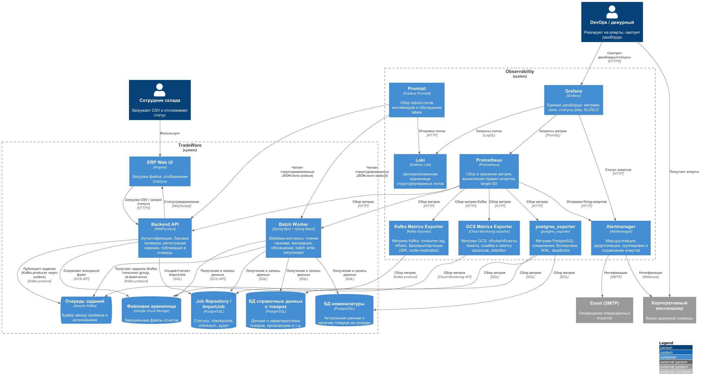

# ADR-002: Единый контур наблюдаемости (метрики, логи, алерты) на базе Prometheus/Grafana/Loki/Alertmanager

## Общая информация

1. Автор ADR - Дмитрий Ренев
2. Статус - На согласовании
3. Согласующие - Дмитрий Бардин
4. Связанные решения - [ADR-001: Пакетная обработка загрузок остатков с использованием Spring Batch](../../Task4/results/ADR.md)

## Контекст

В исходном состоянии у TradeWare нет средств мониторинга: только логи в файл и стандартный
мониторинг ресурсов VM и WildFly. Из-за этого в случае ошибок трудно отследить причину
возникновения и свести имеющиеся логи и метрики в одну картину.

### Требования к решению

1. **Три столпа наблюдаемости:** метрики, логи, (опционально) трассировка.
2. **Сквозная корреляция:** один и тот же `jobId`/`fileId` (и `traceId`) в метриках, логах и событиях, чтобы связать загрузку файла, исполнение Spring Batch job и ошибку данных.
3. **Backpressure-наблюдаемость:** consumer lag Kafka (в сообщениях и во времени) как ранний индикатор перегрузки.
4. **Оповещение:** своевременные алерты о деградации и сбоях дежурной команде. Маршрутизация по приоритетам, дедупликация и группировка, подавление шторма.
5. **Эксплуатация:** минимизировать число новых постоянно живущих компонентов.

## Рассмотренные варианты

### Вариант №1 «OSS-стек Prometheus + Grafana + Loki + Alertmanager»
Метрики - Prometheus, логи - Promtail → Loki, визуализация - Grafana, алерты - Alertmanager.

### Вариант №2 «GCP Cloud Monitoring + Cloud Logging + Cloud Trace»
Полностью managed-стек GCP (Operations Suite). Агентами собираются метрики/логи, алерты - в GCP Alerting.

### Вариант №3 «Prometheus + Grafana + ELK/OpenSearch»
Метрики - Prometheus, логи - Elasticsearch/OpenSearch + Kibana.

### Вариант №4 «Коммерческий APM (Datadog/New Relic/Dynatrace)»
SaaS APM с агентами, метриками, логами, трейсами и алертами "в одном окне".

## Сравнение альтернатив

| Вариант | Преимущества | Недостатки |
|---|---|---|
| №1 OSS-стек | Единый контролируемый контур; стандарт де-факто для K8s; отличная интеграция с Java (Micrometer/Actuator); нет vendor lock-in | Требует эксплуатации (хранение, ретенция, HA Prometheus/Loki); надо настраивать алерты и дашборды вручную |
| №2 GCP Operations | Managed; быстрый старт | Vendor lock-in; цена растёт с объёмом; метрики Spring Batch надо конвертировать |
| №3 ELK | Мощный полнотекстовый поиск по логам; зрелые дашборды | Тяжелее по ресурсам и эксплуатации, чем Loki; избыточно для структурированных JSON-логов |
| №4 Коммерческий APM | Быстрый старт | Стоимость лицензий и агентов; lock-in; избыточно на старте для двух-трёх сервисов |

## Принятое решение

Принято решение №1 - **OSS-стек Prometheus + Grafana + Loki + Alertmanager**.
Трассировка (**OpenTelemetry → Grafana Tempo**) закладывается как **опциональный следующий шаг**,
не входящий в обязательный контур первого этапа.

Диаграмма контейнеров с добавленным контуром наблюдаемости:

### Обоснование

1. **Естественная интеграция с Java 11/Spring.** Spring Boot Actuator + Micrometer экспортируют
   метрики Spring Batch (`spring.batch.job.*`, `spring.batch.step.*`) и JVM/HikariCP в формате
   Prometheus без кастомного кода; для WildFly доступен встроенный `jmx_exporter` Java Agent
   (подключается к JVM как agent, экспонирует `/metrics`, отдельный контейнер не нужен).
2. **Cloud-native и переносимость.** Стек идентично работает в Docker Compose (локально),
   Kubernetes и GCP, что важно для поэтапного выхода из монолита.
3. **Метрики backpressure "из коробки".** Consumer lag Kafka - ключевой SLI для
   пиковых часов и для HPA-автоскейлинга worker'ов.
4. **Логи как JSON в stdout → Loki.** Структурированные логи с обязательными полями `jobId`,
   `fileId`, `traceId` дешево собираются Promtail'ом и коррелируются с метриками в Grafana.
5. **Alertmanager** закрывает маршрутизацию по приоритетам, группировку, дедупликацию и
   подавление шторма - критично при каскадных сбоях в пике.
6. **Отсутствие lock-in и низкая стоимость.** Open-source, прогнозируемая стоимость хранения,
   возможность в будущем заменить/дополнить managed-сервисом (например, Grafana Cloud) без
   переработки инструментации.

### Три столпа наблюдаемости

**1. Метрики**
- **Batch Worker (Spring Boot):** `/actuator/prometheus` - Micrometer + Spring Batch + HikariCP + JVM.
- **Backend API (WildFly):** встроенный `jmx_exporter` Java Agent (in-process, отдельного контейнера нет) отдаёт `/metrics` на выделенном HTTP-порту - HTTP-метрики, JVM/JMX, метрики публикации в очередь; Prometheus скрейпит сервис напрямую.
- **PostgreSQL (все три БД):** `postgres_exporter` для `Job Repository`, **БД справочных данных** и `БД номенклатуры` - соединения, блокировки, WAL, deadlocks, cache-hit; отдельно - свежесть и латентность чтения справочника.
- **Очередь (Apache Kafka):** `Kafka Exporter` - consumer lag (в сообщениях и секундах), offsets, under-replicated партиции/ISR.
- **Файловое хранилище (Google Cloud Storage):** exporter GCS-метрик через Cloud Monitoring - объём и число объектов бакета, latency и ошибки запросов, возраст объектов против retention; плюс клиентские метрики API/Worker по операциям с GCS.

**2. Логи**
- Все сервисы пишут **структурированные JSON-логи в stdout**.
- Обязательные поля: `timestamp`, `level`, `service`, `jobId`, `fileId`, `traceId`, `step`, `event`,
  `warehouseId`, `rowsProcessed`, `durationMs`, `errorCode`.
- Promtail добавляет labels (`namespace`, `app`, `pod`) и отправляет в Loki.

**3. Трассировка (опционально, следующий этап)**
- OpenTelemetry SDK/agent → OTLP → Grafana Tempo; сквозной `traceId` от API через очередь в worker.
- Внедряется после стабилизации метрик и логов; `traceId` в логах уже сейчас обеспечивает корреляцию.

## Следствия принятого решения

**Положительные**
- Единый контур наблюдаемости для монолита, worker'ов, БД и очереди; корреляция по jobId/traceId.
- Раннее обнаружение перегрузки через backpressure-метрики → автоскейлинг до деградации.
- Формализованные SLI/SLO и error budget вместо реакции на жалобы пользователей.
- Совместимость с будущей микросервисной архитектурой.

**Отрицательные / компромиссы**
- Появляются новые компоненты, требующие эксплуатации (HA, ретенция, стоимость хранения).
- Нужна дисциплина структурированного логирования и договорённость о полях.
- Требуется настроить правила алертов и дашборды.

**Риски и меры**
- Шторм алертов → группировка/ингибирование/pause в Alertmanager.
- Рост объёмов логов/метрик → ретенция, сэмплирование, downsample.
- Зашумлённость метрик → фиксированный каталог ключевых метрик (см. [metrics.md](./metrics.md)).

## Резюме

Таким образом, использование **OSS-стек Prometheus + Grafana + Loki + Alertmanager** удовлетворяет заявленным требованиями и имеет потенциал к дальнейшему развитию.
